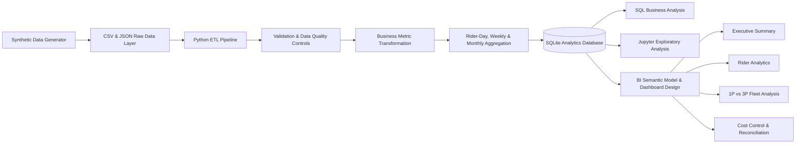
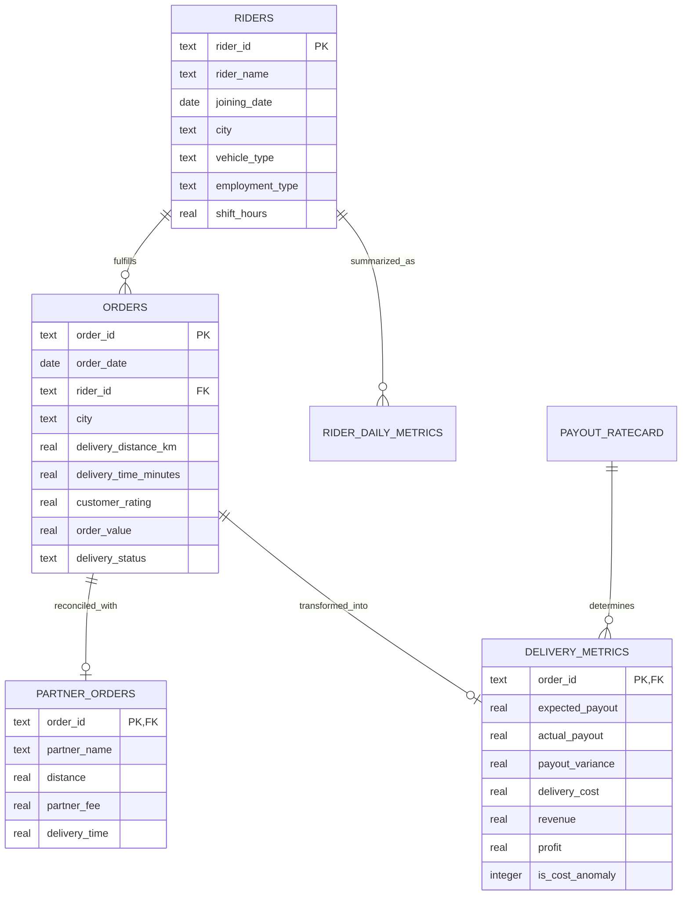

# Delivery Operations Analytics & Cost Intelligence System

End-to-end analytics project for last-mile delivery operations, combining **Python ETL pipelines, SQL analytics, SQLite, operational KPI modeling, payout reconciliation, statistical cost anomaly detection, and interactive dashboarding**.

The system processes **60K+ delivery orders across 600 riders** to analyze delivery costs, rider performance, fleet economics, payout accuracy, and operational trends across first-party (1P) and third-party (3P) logistics channels.

---

## Project Overview

Delivery operations teams need to continuously balance service volume, rider capacity, delivery performance, and unit economics.

This project builds a reproducible analytics workflow that transforms raw operational data into validated analytical datasets, SQL-based business insights, and decision-ready dashboards.

The analysis focuses on five business questions:

- How does **Cost Per Delivery (CPD)** vary across cities, months, riders, and fleet models?
- Which riders demonstrate the strongest productivity and utilization?
- How do **1P and 3P logistics channels** compare in cost and operational performance?
- Are rider payouts and third-party partner invoices consistent with approved rate cards?
- Which deliveries exhibit unusually high costs and require operational investigation?

---

## Project Highlights

- Processed **60,075 raw delivery records** and **600 rider profiles**.
- Built a reproducible **Python ETL pipeline** for validation, deduplication, transformation, aggregation, and database loading.
- Parsed and reconciled **12K third-party delivery records from nested JSON feeds**.
- Developed SQL analytics for **CPD, rider productivity, utilization, fleet comparison, payout reconciliation, and time-series trends**.
- Created weekly and monthly analytical marts for recurring KPI reporting.
- Identified **2,433 high-cost deliveries** using statistical threshold-based anomaly detection.
- Designed a four-page BI dashboard specification covering executive, rider, fleet, and cost-control analytics.
- Built a standalone interactive dashboard for offline exploration of operational KPIs.

---

## Key Results

| Metric | Result |
|---|---:|
| Rider Profiles | 600 |
| Raw Order Records | 60,075 |
| Valid Orders After ETL | 59,990 |
| Delivered Orders | 56,912 |
| Third-Party Delivery Records | 11,998 |
| Average Cost Per Delivery | INR 57.16 |
| Statistical Cost Anomalies | 2,433 |
| Analysis Period | Jan 2024 - Dec 2025 |

---

## Analytics Architecture



---

## Data Model



---

## Dataset Description

The project uses reproducible synthetic operational data designed to simulate common data-quality and analytics challenges in last-mile delivery operations.

| Source | Data Grain | Records | Purpose |
|---|---|---:|---|
| `riders.csv` | One rider | 600 | Rider profiles and planned shifts |
| `orders.csv` | One delivery order | 60,075 raw | Delivery activity and outcomes |
| `payout_ratecard.csv` | One vehicle type | 3 | Contract payout rules |
| `third_party_feed.json` | One partner delivery | 12,000 raw | Third-party invoice reconciliation |

The raw data intentionally includes:

- Duplicate order records.
- Invalid date values.
- Third-party partner records that no longer match after order cleaning.
- Differences between expected and actual payout amounts.

These conditions are used to demonstrate data validation, quality auditing, reconciliation, and exception analysis.

---

## ETL Pipeline

The ETL workflow converts raw operational data into validated, analysis-ready datasets.

### 1. Data Extraction

- Loads rider, order, and payout-rate-card CSV files.
- Parses nested JSON feeds containing third-party logistics records.

### 2. Data Validation

The pipeline validates:

- Date formats.
- Numeric ranges.
- Business category values.
- Rider foreign-key relationships.
- Unique order identifiers.
- Required fields.

### 3. Data Cleaning

- Removes duplicate order records.
- Rejects malformed dates and invalid records.
- Standardizes operational fields.
- Tracks rejected records through ETL audit outputs.

### 4. Business Metric Transformation

The pipeline calculates:

- Expected rider payout.
- Actual payout.
- Payout variance.
- Delivery cost.
- Allocated revenue.
- Profit.
- Profit margin.
- Statistical cost-anomaly indicators.

### 5. Analytical Aggregation

Operational data is aggregated into:

- Rider-day performance metrics.
- Weekly KPI tables.
- Monthly KPI tables.

### 6. Database Loading

Source tables, transformed datasets, and analytical marts are loaded into SQLite within a single transaction.

---

## KPI Framework

| KPI | Business Definition |
|---|---|
| Cost Per Delivery | Total delivery cost / delivered orders |
| Rider Productivity | Delivered orders / planned shift hours |
| Utilization Rate | Active delivery hours / planned shift hours |
| Expected Payout | Base payout + distance payout + per-order payout |
| Payout Variance | Actual payout - expected payout |
| Revenue | Allocated platform commission + service fee |
| Profit | Revenue - delivery cost |
| Profit Margin | Profit / revenue |
| Cost Anomaly | Delivery cost greater than mean + 2 population standard deviations |

Detailed business rules are documented in:

- [`docs/kpi_documentation.md`](docs/kpi_documentation.md)
- [`docs/data_dictionary.md`](docs/data_dictionary.md)

---

## SQL Analytics

The SQL analysis layer focuses on operational and business decision-making.

The query pack includes:

- Cost Per Delivery by city.
- Monthly CPD trends.
- Rider-level cost and performance analysis.
- Top and bottom riders by normalized productivity.
- Rider utilization analysis.
- First-party versus third-party fleet economics.
- 1P vs 3P delivery cost comparison.
- Rate-card payout reconciliation.
- Largest invoice and payout variances.
- Weekly operational trends.
- Monthly performance trends.
- City contribution to delivery volume.
- Rider performance ranking.
- Cost anomaly analysis.
- Statistical cost-threshold computation using SQLite SQL.

Explore the complete SQL query pack:

[`sql/analytics_queries.sql`](sql/analytics_queries.sql)

---

# Dashboard

The project includes a **four-page business intelligence dashboard design** covering executive KPIs, rider performance, fleet economics, and cost-control analysis.

A standalone interactive HTML dashboard is also included for offline exploration of filters, KPIs, trends, rider rankings, fleet comparisons, and anomaly records.

## Interactive Dashboard

Open:

[`powerbi/delivery_operations_dashboard.html`](powerbi/delivery_operations_dashboard.html)

The dashboard can be opened locally in Edge or Chrome without requiring a database connection, Python environment, or external server.

The Power BI model relationships, DAX measures, filters, layout, and interaction specifications are documented in:

[`powerbi/dashboard_design.md`](powerbi/dashboard_design.md)

---

## Executive Summary Dashboard


**Focus Areas**

- Total delivery volume.
- Average Cost Per Delivery.
- Monthly CPD trends.
- City-level performance.
- Delivery volume distribution.
- Operational anomaly monitoring.

---

## Rider Analytics Dashboard


**Focus Areas**

- Rider productivity.
- Utilization rate.
- Delivered orders.
- Rider-level CPD.
- Performance rankings.
- Underperforming rider identification.

---

## 1P vs 3P Fleet Analysis


**Focus Areas**

- First-party versus third-party CPD.
- Delivery volume comparison.
- Distance and cost analysis.
- Productivity differences.
- Fleet utilization.
- Partner performance.

---

## Cost Control & Reconciliation


**Focus Areas**

- Expected versus actual payouts.
- Payout variance.
- Rate-card reconciliation.
- High-cost deliveries.
- Statistical anomaly thresholds.
- Exception-level operational investigation.

---

## Key Business Insights

### 1. Delivery Volume

**Bengaluru generated the highest delivery volume with 15,973 completed deliveries**, making it the largest operating market in the dataset.

### 2. Cost Per Delivery

Overall **Cost Per Delivery was INR 57.16**.

City-level CPD remained relatively stable, while **Pune recorded the lowest CPD at INR 54.79**.

### 3. First-Party vs Third-Party Fleet Economics

First-party delivery CPD was **INR 57.80**, compared with **INR 55.89 for third-party deliveries** in the generated scenario.

The difference demonstrates how fleet models can be evaluated using cost, delivery volume, utilization, and productivity metrics rather than cost alone.

### 4. Cost Anomaly Detection

The statistical cost threshold was calculated at **INR 92.78**.

A total of **2,433 deliveries exceeded the threshold** and were flagged for operational review.

### 5. Delivery Volume Trend

Monthly delivery volume increased from **2,301 deliveries in January 2024 to 2,597 deliveries in December 2025**, with recurring seasonal variation across the analysis period.

---

## Statistical Cost Anomaly Detection

High-cost deliveries are identified using a statistical threshold:

```text
Cost Threshold = Population Mean + (2 x Population Standard Deviation)
```

Deliveries exceeding the calculated threshold are flagged for further operational investigation.

This approach provides a reproducible baseline for identifying unusual delivery costs while keeping the methodology transparent and interpretable.

---

## Repository Structure

```text
delivery-operations-dashboard/
|
|-- data/
|   |-- riders.csv
|   |-- orders.csv
|   |-- payout_ratecard.csv
|   `-- third_party_feed.json
|
|-- docs/
|   |-- data_dictionary.md
|   `-- kpi_documentation.md
|
|-- etl/
|   `-- etl_pipeline.py
|
|-- notebooks/
|   `-- delivery_operations_analysis.ipynb
|
|-- powerbi/
|   |-- mockups/
|   |   |-- 01_executive_summary.svg
|   |   |-- 02_rider_analytics.svg
|   |   |-- 03_1p_vs_3p.svg
|   |   `-- 04_cost_control.svg
|   |
|   |-- dashboard_design.md
|   `-- delivery_operations_dashboard.html
|
|-- scripts/
|   |-- generate_data.py
|   |-- generate_dashboard_mockups.py
|   `-- generate_interactive_dashboard.py
|
|-- sql/
|   |-- schema.sql
|   `-- analytics_queries.sql
|
|-- delivery_operations.db
|-- requirements.txt
`-- README.md
```

---

## Run the Project Locally

### 1. Clone the Repository

```bash
git clone https://github.com/ms1706g/Delivery-Operations-Analytics-Dashboard-.git
cd Delivery-Operations-Analytics-Dashboard-
```

### 2. Create the Dataset

```bash
python scripts/generate_data.py
```

### 3. Run the ETL Pipeline

```bash
python etl/etl_pipeline.py
```

### 4. Generate Dashboard Mockups

```bash
python scripts/generate_dashboard_mockups.py
```

### 5. Generate the Interactive Dashboard

```bash
python scripts/generate_interactive_dashboard.py
```

---

## Run the Jupyter Notebook

Create a virtual environment:

```bash
python -m venv .venv
```

Activate the environment on Windows:

```powershell
.\.venv\Scripts\Activate.ps1
```

Install dependencies:

```bash
pip install -r requirements.txt
```

Launch Jupyter Lab:

```bash
jupyter lab notebooks/delivery_operations_analysis.ipynb
```

---

## Inspect the Analytics Database

```bash
python -c "import sqlite3; c=sqlite3.connect('delivery_operations.db'); print(c.execute('SELECT COUNT(*) FROM delivery_metrics').fetchone())"
```

---

## Technology Stack

| Category | Technologies |
|---|---|
| Programming | Python |
| Data Analysis | Pandas, NumPy |
| Querying | SQL |
| Database | SQLite |
| Data Engineering | ETL Pipelines, Data Validation, JSON Parsing |
| Business Intelligence | Power BI Design Patterns, Interactive Dashboarding |
| Statistical Analysis | Threshold-Based Cost Anomaly Detection |
| Development Tools | Git, GitHub, Jupyter Notebook |

---

## Skills Demonstrated

- SQL business analysis.
- Python data transformation.
- ETL pipeline development.
- Data-quality validation and auditing.
- JSON parsing and transformation.
- Relational data modeling.
- Operational KPI development.
- Cost Per Delivery analysis.
- Rider productivity and utilization analysis.
- First-party vs third-party fleet comparison.
- Payout and invoice reconciliation.
- Statistical threshold-based anomaly detection.
- Analytical database development.
- Business intelligence dashboard design.
- Business insight communication.

---

## Future Improvements

Potential extensions include:

- Replace synthetic datasets with anonymized public logistics datasets.
- Add automated ETL and data-quality tests.
- Implement rolling-window and segment-specific anomaly thresholds.
- Add forecasting for delivery volume and Cost Per Delivery.
- Build a deployed web-based analytics application.
- Add orchestration for scheduled pipeline execution.

---

## Author

**Manan Shiva**

B.Tech Computer Science & Engineering  
Indian Institute of Information Technology Kota

**LinkedIn:** [linkedin.com/in/manan-shiva-483b0227b](https://linkedin.com/in/manan-shiva-483b0227b)

**GitHub:** [github.com/ms1706g](https://github.com/ms1706g)

## AWS Cloud Integration

The project has been extended with a cloud-based data engineering workflow using AWS. The original local SQLite analytics pipeline and Power BI dashboard remain unchanged.

### Cloud Architecture

The cloud pipeline follows a Bronze-Silver-Gold data processing approach:

1. **Bronze Layer:** Raw operational data is ingested, enriched with ingestion metadata, and stored as JSONL files.
2. **Silver Layer:** Data is validated, deduplicated, transformed, and stored in Parquet format. Invalid records are separated into a quarantine dataset.
3. **Gold Layer:** Curated analytical marts are generated for city-level delivery performance and rider-level performance and estimated payouts.

### AWS Services

| AWS Service | Purpose |
|---|---|
| Amazon S3 | Stores Bronze, Silver, and Gold datasets |
| AWS Glue Data Catalog | Maintains metadata for Gold Parquet tables |
| Amazon Athena | Runs SQL queries directly on Gold datasets |
| Boto3 | Connects the Python pipeline to Amazon S3 |

### Amazon S3 Data Organization

The project datasets are stored in the S3 bucket using separate layer prefixes:

```text
s3://manan-delivery-ops-analytics-2026/
│
├── bronze/
│   ├── orders/
│   ├── riders/
│   ├── payout_ratecard/
│   └── third_party_feed/
│
├── silver/
│   ├── orders/
│   ├── riders/
│   ├── payout_ratecard/
│   ├── third_party_feed/
│   └── quarantine/
│
├── gold/
│   ├── city_performance/
│   ├── rider_performance/
│   ├── delivery_performance_by_city.parquet
│   └── rider_performance_and_payout.parquet
│
└── athena-results/
```
