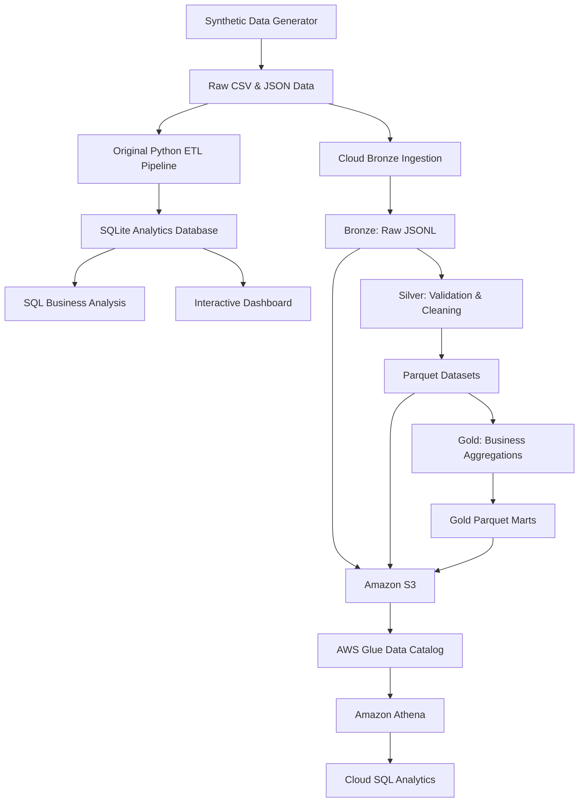
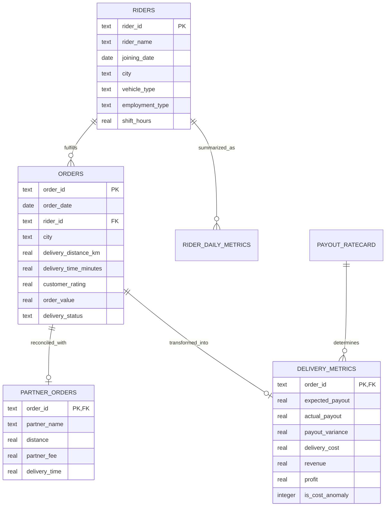
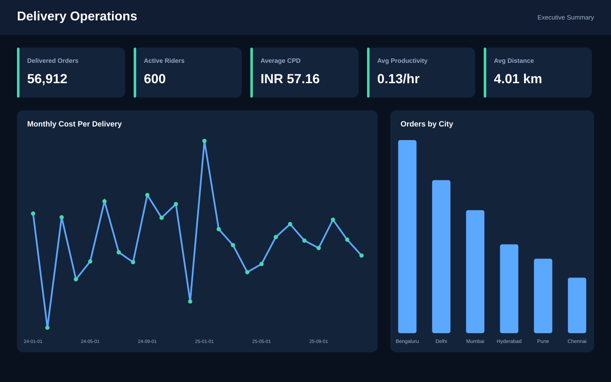
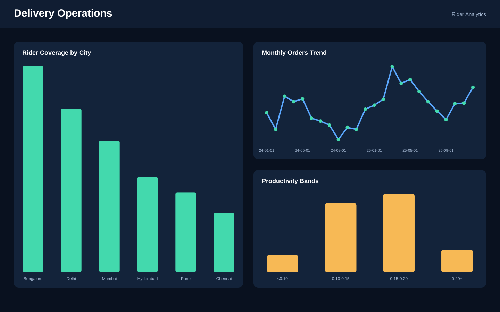
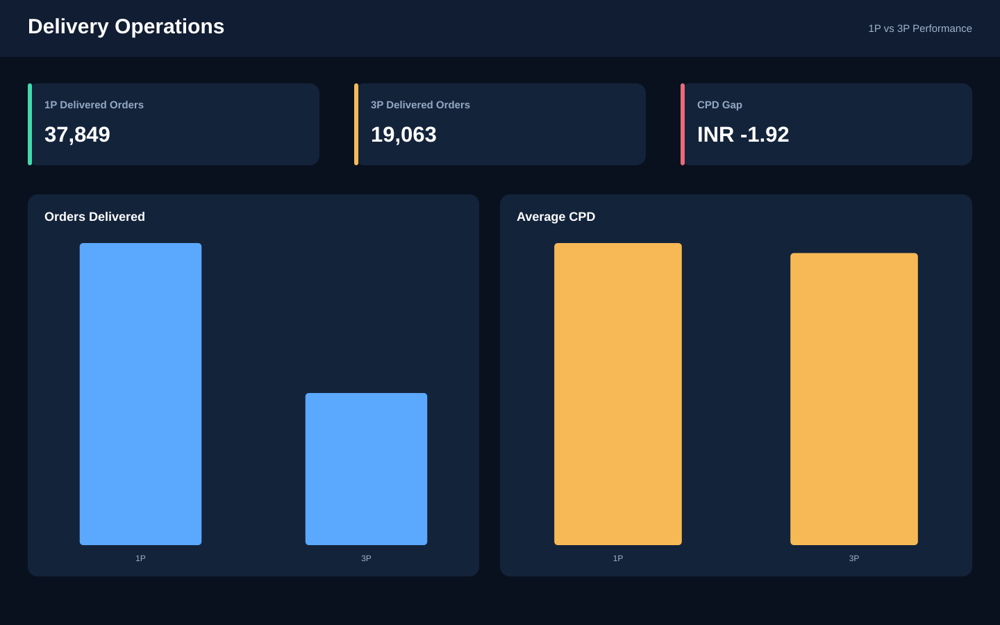
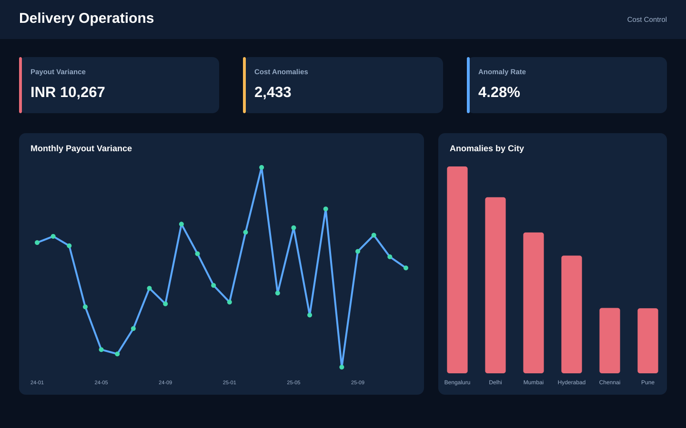

# Delivery Operations Analytics & Cost Intelligence System

An end-to-end analytics and data engineering project for last-mile delivery operations, combining **Python ETL pipelines, SQL analytics, SQLite, data quality engineering, operational KPI modeling, cost intelligence, interactive dashboards, and AWS cloud integration**.

The system processes 60K+ delivery orders across 600 riders to analyze delivery costs, rider performance, fleet economics, payout calculations, and operational trends across first-party (1P) and third-party (3P) logistics channels.

It also implements a cloud-connected **Bronze–Silver–Gold data architecture** using Amazon S3, AWS Glue Data Catalog, Amazon Athena, and Python Boto3.

---

## Project Overview

Delivery operations teams need to continuously balance service volume, rider capacity, delivery performance, and unit economics.

This project builds a reproducible analytics workflow that transforms raw operational data into validated analytical datasets, SQL-based business insights, and decision-ready dashboards.

The project combines two complementary workflows:

- **Analytics workflow:** Python ETL, SQLite, SQL business analysis, KPI modeling, and dashboarding.
- **Cloud data engineering workflow:** Bronze–Silver–Gold transformations, Parquet datasets, Amazon S3 storage, Glue Data Catalog, and Athena SQL analytics.

The analysis focuses on five business questions:

- How does Cost Per Delivery (CPD) vary across cities, months, riders, and fleet models?
- Which riders demonstrate the strongest productivity and utilization?
- How do 1P and 3P logistics channels compare in cost and operational performance?
- Are rider payouts and third-party partner invoices consistent with approved rate cards?
- Which deliveries exhibit unusually high costs and require operational investigation?

---

## Project Highlights

- Processed **60,075 raw delivery records** and **600 rider profiles**.
- Built reproducible Python ETL pipelines for validation, deduplication, transformation, aggregation, and database loading.
- Parsed and processed nested JSON feeds containing 12,000 third-party delivery records.
- Implemented a Bronze–Silver–Gold data architecture.
- Developed a Silver layer with schema validation, duplicate handling, rejected-record quarantine, and Parquet output.
- Built Gold analytical marts for city performance and rider performance/payout analysis.
- Integrated Python ETL workflows with Amazon S3 using Boto3.
- Uploaded 12 Bronze, Silver, and Gold pipeline objects to AWS S3.
- Created an AWS Glue Data Catalog database with two external Parquet tables.
- Executed SQL analytics directly on S3 datasets using Amazon Athena.
- Validated cloud query results against local Gold datasets.
- Developed SQL analytics for CPD, rider productivity, utilization, fleet comparison, payout reconciliation, and time-series trends.
- Identified 2,433 high-cost deliveries using statistical threshold-based anomaly detection.
- Designed a four-page BI dashboard specification covering executive, rider, fleet, and cost-control analytics.
- Built a standalone interactive dashboard for offline exploration of operational KPIs.

---

## Key Results

| Metric | Result |
|---|---:|
| Rider Profiles | 600 |
| Raw Order Records | 60,075 |
| Valid Orders After ETL | 59,990 |
| Delivered Orders | 56,912 |
| Cancelled Orders | 2,147 |
| Failed Orders | 931 |
| Third-Party Raw Records | 12,000 |
| Average Cost Per Delivery | INR 57.16 |
| Statistical Cost Anomalies | 2,433 |
| Analysis Period | Jan 2024 – Dec 2025 |

---

## Analytics Architecture

### Overall Architecture



### Cloud Data Architecture

```text
Raw CSV / JSON Sources
         |
         v
   Bronze Ingestion
         |
         v
   Bronze Layer
   Raw JSONL batches
         |
         v
   Silver Transformation
   - Schema validation
   - Deduplication
   - Type conversion
   - Data quality checks
   - Rejected-record quarantine
         |
         v
   Silver Layer
   Cleaned Parquet datasets
         |
         v
   Gold Transformation
   - City performance mart
   - Rider performance and payout mart
         |
         v
   Gold Layer
   Business-ready Parquet datasets
         |
         v
      Amazon S3
         |
         v
 AWS Glue Data Catalog
         |
         v
    Amazon Athena
         |
         v
     SQL Analytics
```

---

## Data Model



---

## Dataset Description

The project uses reproducible synthetic operational data designed to simulate common data-quality and analytics challenges in last-mile delivery operations.

| Source | Data Grain | Records | Purpose |
|---|---|---:|---|
| `riders.csv` | One rider | 600 | Rider profiles and planned shifts |
| `orders.csv` | One delivery order | 60,075 raw | Delivery activity and outcomes |
| `payout_ratecard.csv` | One vehicle type | 3 | Contract payout rules |
| `third_party_feed.json` | One partner delivery | 12,000 raw | Third-party invoice reconciliation |

The raw data intentionally includes duplicate order records, invalid dates, partner records that no longer match after cleaning, and payout differences.

These conditions demonstrate data validation, quality auditing, reconciliation, and exception analysis.

---

## ETL Pipeline

### 1. Original Analytics ETL

The original pipeline:

- Loads rider, order, and payout-rate-card CSV files.
- Parses nested JSON feeds.
- Validates dates, numeric ranges, business categories, relationships, and required fields.
- Removes duplicates and rejects malformed records.
- Calculates expected payouts, payout variances, delivery costs, revenue, profit, and cost anomalies.
- Produces rider-day, weekly, and monthly analytical aggregates.
- Loads transformed datasets into SQLite within a transaction.

### 2. Cloud Bronze Layer

- Ingests CSV and JSON source records.
- Preserves source metadata, batch identifiers, ingestion timestamps, and SHA-256 checksums.
- Converts source records into JSONL batch files.
- Uploads selected complete batches to Amazon S3.

### 3. Cloud Silver Layer

- Reads Bronze JSONL batches.
- Validates schemas and required fields.
- Removes exact duplicates.
- Normalizes dates, numeric values, and string fields.
- Preserves optional missing customer ratings.
- Quarantines rejected records.
- Writes cleaned datasets as Parquet.
- Generates a JSON data quality report.

### 4. Cloud Gold Layer

Creates two business-ready analytical marts:

**City Performance Mart**
- Total orders by city.
- Delivered, cancelled, and failed orders.
- Delivery success rate.
- Average delivery time.
- Average delivery distance.
- Average customer rating.
- Delivered order value.

**Rider Performance and Payout Mart**
- Rider profile and employment information.
- Order counts by delivery status.
- Total delivered distance.
- Average delivery time and rating.
- Estimated rider payout.
- Delivery success rate.

The estimated payout is calculated using the implemented rate-card formula. It should not be interpreted as verified actual company payout.

---

## Amazon Web Services Integration

### Services Used

| AWS Service | Purpose |
|---|---|
| Amazon S3 | Cloud storage for Bronze, Silver, and Gold datasets |
| AWS IAM | Restricted access management |
| AWS Glue Data Catalog | Database and table metadata management |
| Amazon Athena | SQL queries on S3-backed Parquet datasets |
| AWS CLI | Local AWS authentication and command-line operations |
| Boto3 | Python integration with Amazon S3 |

**AWS Region:** Asia Pacific (Mumbai) – `ap-south-1`

### Amazon S3 Storage Architecture

Bucket:

`manan-delivery-ops-analytics-2026`

```text
manan-delivery-ops-analytics-2026/
│
├── bronze/
│   ├── orders/
│   ├── riders/
│   ├── payout_ratecard/
│   └── third_party_feed/
│
├── silver/
│   ├── orders/
│   ├── riders/
│   ├── payout_ratecard/
│   ├── third_party_feed/
│   ├── quarantine/
│   └── quality_report.json
│
├── gold/
│   ├── delivery_performance_by_city.parquet
│   ├── rider_performance_and_payout.parquet
│   ├── city_performance/
│   └── rider_performance/
│
├── athena-results/
│
└── test/
```

The original Gold objects were retained, and copies were placed into separate S3 prefixes for independent Athena table registration.

### Upload Summary

| Layer | Uploaded Objects |
|---|---:|
| Bronze | 4 |
| Silver | 6 |
| Gold | 2 |
| **Total pipeline objects** | **12** |

The S3 bucket contained 14 objects, including two integration test objects, with approximately 32.2 MiB reported storage at verification time.

### Python Boto3 Integration

Implemented reusable Python modules:

- `aws/s3_client.py` – Creates the S3 client and verifies bucket access.
- `aws/s3_uploader.py` – Provides reusable file-upload functionality.
- `aws/upload_bronze.py` – Uploads selected complete Bronze batches.
- `aws/upload_silver.py` – Uploads Silver Parquet datasets and quality outputs.
- `aws/upload_gold.py` – Uploads Gold analytical datasets.

AWS credentials are configured through the AWS CLI credentials provider rather than hardcoded in source code.

The project IAM policy uses restricted S3 access to the project bucket and does not grant object deletion permission.

---

## AWS Glue Data Catalog

Created Glue database:

`delivery_ops_analytics`

Registered two external Parquet tables:

| Table | Columns | S3 Dataset |
|---|---:|---|
| `city_performance` | 10 | Gold city performance |
| `rider_performance` | 14 | Gold rider performance and payout |

The catalog tables allow Athena to query the datasets directly from S3.

---

## Amazon Athena SQL Analytics

Used Amazon Athena to run SQL queries against the Gold Parquet datasets stored in S3.

### 1. City Performance Query

```sql
SELECT
    city,
    total_orders,
    delivered_orders,
    delivery_success_rate_pct
FROM city_performance
ORDER BY total_orders DESC;
```

### 2. Top Riders by Estimated Payout

```sql
SELECT
    rider_id,
    rider_name,
    city,
    total_orders,
    delivered_orders,
    estimated_total_payout,
    delivery_success_rate_pct
FROM rider_performance
ORDER BY estimated_total_payout DESC
LIMIT 10;
```

### 3. Overall Rider and Order Reconciliation

```sql
SELECT
    COUNT(*) AS total_riders,
    SUM(total_orders) AS total_orders,
    SUM(delivered_orders) AS delivered_orders,
    SUM(cancelled_orders) AS cancelled_orders,
    SUM(failed_orders) AS failed_orders,
    ROUND(SUM(estimated_total_payout), 2)
        AS total_estimated_payout
FROM rider_performance;
```

### Cloud Validation Results

The overall Athena aggregation was compared with the local Gold dataset.

| Metric | Athena Result |
|---|---:|
| Total Riders | 600 |
| Total Orders | 59,990 |
| Delivered Orders | 56,912 |
| Cancelled Orders | 2,147 |
| Failed Orders | 931 |
| Estimated Total Payout | INR 29,87,169.83 |

All reported reconciliation values matched the local Gold output.

This validates the S3 upload, Parquet table definitions, and cloud SQL results for the tested datasets.

---

## KPI Framework

| KPI | Business Definition |
|---|---|
| Cost Per Delivery | Total delivery cost / delivered orders |
| Rider Productivity | Delivered orders / planned shift hours |
| Utilization Rate | Active delivery hours / planned shift hours |
| Expected Payout | Base payout + distance payout + per-order payout |
| Payout Variance | Actual payout - expected payout |
| Revenue | Allocated platform commission + service fee |
| Profit | Revenue - delivery cost |
| Profit Margin | Profit / revenue |
| Cost Anomaly | Delivery cost greater than mean + 2 population standard deviations |

Detailed business rules:

- `docs/kpi_documentation.md`
- `docs/data_dictionary.md`

---

## SQL Analytics

The SQL analysis layer focuses on operational and business decision-making.

The query pack includes:

- Cost Per Delivery by city.
- Monthly CPD trends.
- Rider-level cost and performance analysis.
- Top and bottom riders by normalized productivity.
- Rider utilization analysis.
- First-party versus third-party fleet economics.
- Rate-card payout reconciliation.
- Weekly and monthly operational trends.
- City contribution to delivery volume.
- Cost anomaly analysis.

Explore:

`sql/analytics_queries.sql`

---

# Dashboard

The project includes a four-page business intelligence dashboard design covering executive KPIs, rider performance, fleet economics, and cost-control analysis.

A standalone interactive HTML dashboard is also included for offline exploration of filters, KPIs, trends, rider rankings, fleet comparisons, and anomaly records.

## Interactive Dashboard

`powerbi/delivery_operations_dashboard.html`

The dashboard can be opened locally in Edge or Chrome without requiring a database connection, Python environment, or external server.

The Power BI model relationships, DAX measures, filters, layout, and interaction specifications are documented in:

`powerbi/dashboard_design.md`

### Executive Summary Dashboard



**Focus Areas**
- Total delivery volume.
- Average Cost Per Delivery.
- Monthly CPD trends.
- City-level performance.
- Delivery volume distribution.
- Operational anomaly monitoring.

### Rider Analytics Dashboard



**Focus Areas**
- Rider productivity.
- Utilization rate.
- Delivered orders.
- Rider-level CPD.
- Performance rankings.
- Underperforming rider identification.

### 1P vs 3P Fleet Analysis



**Focus Areas**
- First-party versus third-party CPD.
- Delivery volume comparison.
- Distance and cost analysis.
- Productivity differences.
- Fleet utilization.
- Partner performance.

### Cost Control & Reconciliation



**Focus Areas**
- Expected versus actual payouts.
- Payout variance.
- Rate-card reconciliation.
- High-cost deliveries.
- Statistical anomaly thresholds.
- Exception-level operational investigation.

---

## Key Business Insights

### 1. Delivery Volume

Bengaluru generated the highest delivery volume with 15,973 completed deliveries.

### 2. Cost Per Delivery

Overall Cost Per Delivery was INR 57.16.

Pune recorded the lowest CPD at INR 54.79.

### 3. First-Party vs Third-Party Fleet Economics

First-party delivery CPD was INR 57.80, compared with INR 55.89 for third-party deliveries in the generated scenario.

### 4. Cost Anomaly Detection

The statistical cost threshold was INR 92.78.

A total of 2,433 deliveries exceeded the threshold and were flagged for operational review.

### 5. Delivery Volume Trend

Monthly delivery volume increased from 2,301 deliveries in January 2024 to 2,597 deliveries in December 2025.

---

## Statistical Cost Anomaly Detection

High-cost deliveries are identified using:

```text
Cost Threshold = Population Mean
                  + (2 x Population Standard Deviation)
```

Deliveries exceeding the calculated threshold are flagged for further operational investigation.

This approach provides a reproducible baseline for identifying unusual delivery costs.

---

## Repository Structure

```text
delivery-operations-dashboard/
│
├── aws/
│   ├── __init__.py
│   ├── s3_client.py
│   ├── s3_uploader.py
│   ├── upload_bronze.py
│   ├── upload_silver.py
│   └── upload_gold.py
│
├── data/
│   ├── bronze/
│   ├── silver/
│   └── gold/
│
├── docs/
│   ├── data_dictionary.md
│   ├── kpi_documentation.md
│   └── aws-cloud-integration.md
│
├── etl/
│   ├── etl_pipeline.py
│   └── cloud_pipeline/
│       ├── bronze_ingestion.py
│       ├── silver/
│       │   └── transform.py
│       └── gold/
│           ├── build_marts.py
│           └── build_rider_mart.py
│
├── tests/
│   └── cloud_pipeline/
│       └── gold/
│           └── test_gold_marts.py
│
├── notebooks/
├── powerbi/
├── scripts/
├── sql/
├── delivery_operations.db
├── requirements.txt
└── README.md
```

*The structure above highlights the main project components; additional existing files and directories are retained in the repository.*

---

## Run the Project Locally

### 1. Clone the Repository

```bash
git clone https://github.com/ms1706g/Delivery-Operations-Analytics-Dashboard-.git

cd Delivery-Operations-Analytics-Dashboard-
```

### 2. Create the Dataset

```bash
python scripts/generate_data.py
```

### 3. Run the Original ETL Pipeline

```bash
python etl/etl_pipeline.py
```

### 4. Run the Interactive Dashboard Generator

```bash
python scripts/generate_interactive_dashboard.py
```

### 5. Run the Cloud Pipeline

Activate the Python 3.12 virtual environment and install the required dependencies before running the cloud pipeline.

Bronze ingestion:

```bash
python -m etl.cloud_pipeline.bronze_ingestion
```

Silver transformation:

```bash
python -m etl.cloud_pipeline.silver.transform
```

Gold city mart:

```bash
python -m etl.cloud_pipeline.gold.build_marts
```

Gold rider mart:

```bash
python -m etl.cloud_pipeline.gold.build_rider_mart
```

Run Gold tests:

```bash
python -m pytest tests/cloud_pipeline/gold/ -v
```

### 6. Upload Datasets to AWS S3

Configure AWS CLI credentials separately using an appropriately restricted IAM identity.

Then run:

```bash
python -m aws.s3_client
python -m aws.upload_bronze
python -m aws.upload_silver
python -m aws.upload_gold
```

These commands upload the selected local datasets to the configured project bucket. They require valid AWS credentials and the configured bucket and region.

**Note:** Cloud resources and AWS charges depend on account eligibility, usage, and region. Review AWS billing before running additional cloud services.

---

## Technology Stack

| Category | Technologies |
|---|---|
| Programming | Python |
| Data Analysis | Pandas, NumPy |
| Querying | SQL |
| Database | SQLite |
| Data Formats | CSV, JSON, JSONL, Parquet |
| Data Engineering | ETL, Data Validation, Data Quality, Data Modeling |
| Cloud Storage | Amazon S3 |
| Cloud Metadata | AWS Glue Data Catalog |
| Cloud Query Engine | Amazon Athena |
| AWS Integration | Boto3, AWS CLI, IAM |
| Business Intelligence | Power BI Design Patterns, Interactive Dashboarding |
| Statistical Analysis | Threshold-Based Cost Anomaly Detection |
| Development Tools | Git, GitHub, Jupyter Notebook, Pytest |

---

## Skills Demonstrated

- SQL business analysis.
- Python data transformation.
- ETL pipeline development.
- Data quality validation and auditing.
- JSON parsing and transformation.
- Relational data modeling.
- Bronze–Silver–Gold architecture.
- Parquet data processing.
- Amazon S3 integration.
- AWS IAM access management.
- AWS Glue Data Catalog.
- Amazon Athena SQL analytics.
- Boto3-based cloud integration.
- Operational KPI development.
- Cost Per Delivery analysis.
- Rider productivity and utilization analysis.
- Payout calculations and reconciliation.
- Statistical anomaly detection.
- Business intelligence dashboard design.
- Business insight communication.

---

## Future Improvements

Potential extensions include:

- Implement distributed data transformations using Apache Spark and PySpark.
- Run managed ETL jobs using AWS Glue.
- Add automated cloud pipeline orchestration.
- Introduce scheduled data-quality checks and monitoring.
- Add rolling-window and segment-specific anomaly thresholds.
- Build delivery volume and CPD forecasting.
- Expand cloud analytics with additional Athena datasets.
- Develop a deployed web-based analytics application.

---

## Author

**Manan Shiva**

B.Tech Computer Science & Engineering  
Indian Institute of Information Technology Kota

**LinkedIn:** [linkedin.com/in/manan-shiva-483b0227b](https://linkedin.com/in/manan-shiva-483b0227b)

**GitHub:** [github.com/ms1706g](https://github.com/ms1706g)

## AWS Cloud Integration

The project has been extended with a cloud-based data engineering workflow using AWS. The original local SQLite analytics pipeline and Power BI dashboard remain unchanged.

### Cloud Architecture

The cloud pipeline follows a Bronze-Silver-Gold data processing approach:

1. **Bronze Layer:** Raw operational data is ingested, enriched with ingestion metadata, and stored as JSONL files.
2. **Silver Layer:** Data is validated, deduplicated, transformed, and stored in Parquet format. Invalid records are separated into a quarantine dataset.
3. **Gold Layer:** Curated analytical marts are generated for city-level delivery performance and rider-level performance and estimated payouts.

### AWS Services

| AWS Service | Purpose |
|---|---|
| Amazon S3 | Stores Bronze, Silver, and Gold datasets |
| AWS Glue Data Catalog | Maintains metadata for Gold Parquet tables |
| Amazon Athena | Runs SQL queries directly on Gold datasets |
| Boto3 | Connects the Python pipeline to Amazon S3 |

### Amazon S3 Data Organization

The project datasets are stored in the S3 bucket using separate layer prefixes:

```text
s3://manan-delivery-ops-analytics-2026/
│
├── bronze/
│   ├── orders/
│   ├── riders/
│   ├── payout_ratecard/
│   └── third_party_feed/
│
├── silver/
│   ├── orders/
│   ├── riders/
│   ├── payout_ratecard/
│   ├── third_party_feed/
│   └── quarantine/
│
├── gold/
│   ├── city_performance/
│   ├── rider_performance/
│   ├── delivery_performance_by_city.parquet
│   └── rider_performance_and_payout.parquet
│
└── athena-results/
```
